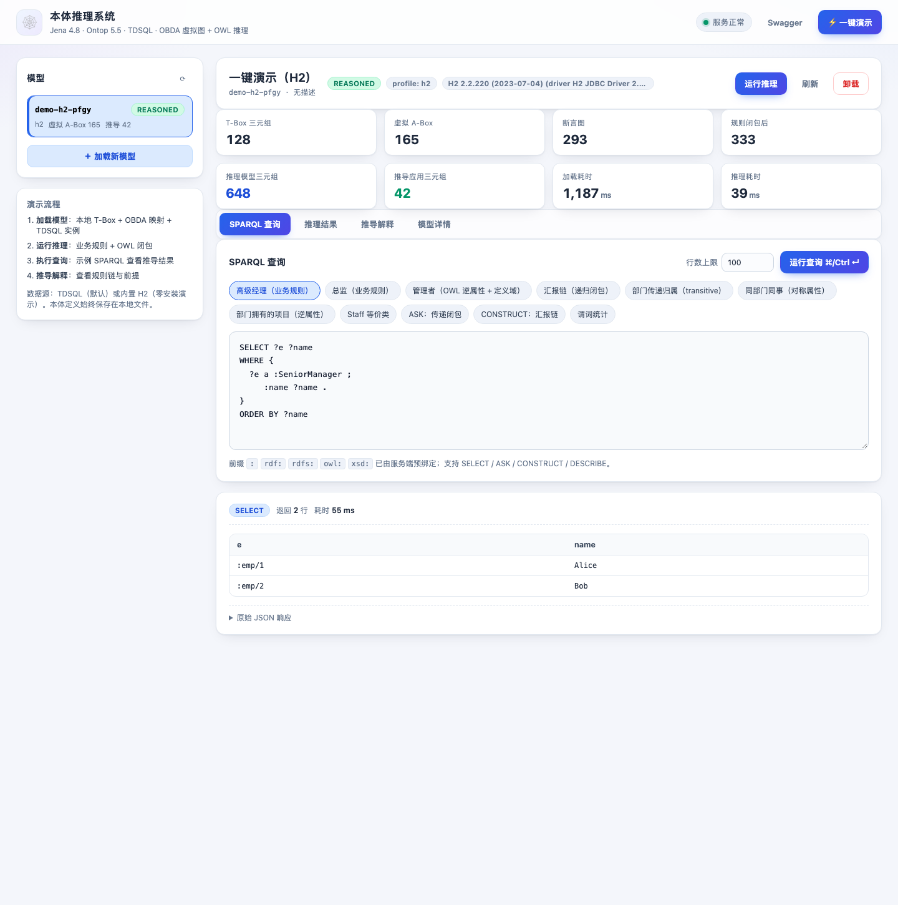
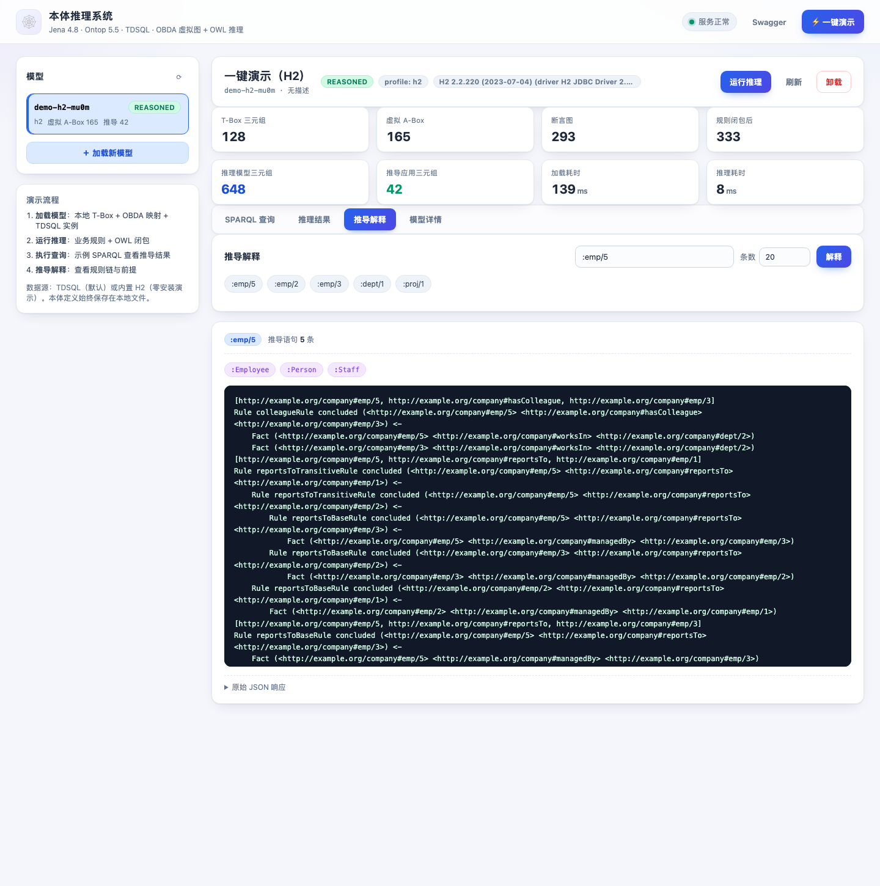
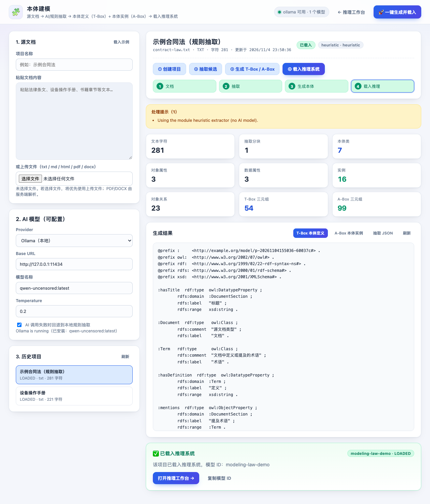
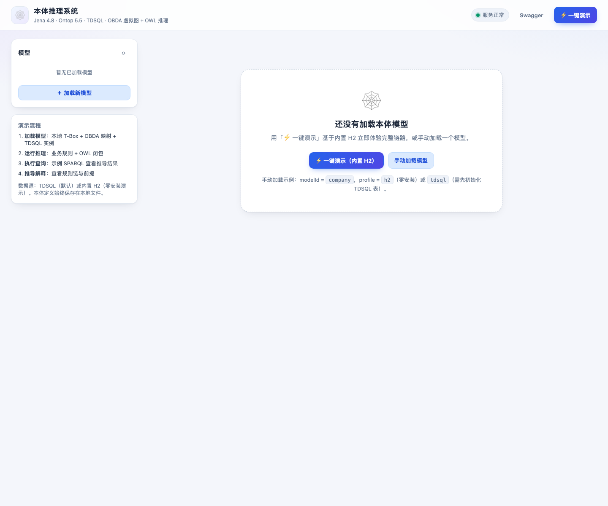

# 本体推理系统：Spring Boot + Jena 4.8 + Ontop 5.5 + TDSQL

一个可以直接用 IntelliJ IDEA 打开并运行的 **本体推理 REST 服务**：

- **本体定义（T-Box）保存在本地文件**：`ontology/company.ttl`（OWL/Turtle）、`ontology/company.rules`（业务规则）
- **本体实例（A-Box）保存在 TDSQL 关系表**：Ontop 通过 OBDA 映射把关系数据实时虚拟成 RDF（不复制、不 ETL）
- **推理**：Jena 4.8 业务规则引擎 + OWL 推理闭包，支持推导过程解释、推理结果物化回库
- **接口**：`/load`、`/reason`、`/query`、`/models`、`/models/{modelId}` 等 REST API + Swagger UI
- **内置演示界面**：启动后打开 <http://localhost:8080/> 即可完成「加载模型 → 推理 → 查询 → 解释」全流程演示，无需前端构建
- **文档驱动本体建模（新模块）**：把法律条文、设备手册、书籍等文档，经可配置 AI（本地 Ollama / OpenAI 兼容 API）或内置规则抽取，自动生成 **T-Box 本体定义** + **A-Box 本体实例** 两份 Turtle 文档，并一键载入多模型推理系统；页面入口 <http://localhost:8080/modeling.html>，详见 [docs/ontology-modeling.md](docs/ontology-modeling.md)
- **开发与移植指南**：想把这套能力搬到别的机器/项目？直接看 [docs/porting-guide.md](docs/porting-guide.md)（技术栈基线、模块边界、最小改造步骤、扩展点与踩坑清单）

技术栈：**Java 11 / Spring Boot 2.7.18 / Apache Jena 4.8.0 / Ontop 5.5.0 / MySQL Connector-J 8.0.33（TDSQL 兼容）/ H2 2.2.220**

---

## 1. 架构

```
                         HTTP / JSON (curl, Swagger, 前端)
                                      │
┌─────────────────────────────────────▼──────────────────────────────────────┐
│ Spring Boot 应用  (com.example.ontology)                                   │
│                                                                            │
│  controller/  ModelController   ReasoningController   QueryController      │
│                    │                   │                   │               │
│  service/     ModelService      ReasoningService      QueryService         │
│                    │                   │                   │               │
│  infrastructure/   ModelLoader / ModelRegistry / ModelFileStore            │
│                    │                   │                   │               │
│         ┌──────────▼─────────┐  ┌──────▼─────────────┐  ┌──▼─────────────┐ │
│         │ Ontop 5.5 (RDF4J)  │  │ Jena 4.8 推理引擎   │  │ InstanceDB     │ │
│         │ OBDA → SQL 重写     │  │ 业务规则 + OWL 闭包 │  │ JDBC 控制面     │ │
│         └──────────┬─────────┘  └────────────────────┘  └──┬─────────────┘ │
└────────────────────┼────────────────────────────────────────┼───────────────┘
                     │ JDBC (MySQL 协议)                       │
             ┌───────▼─────────────────────────────────────────▼──────┐
             │ TDSQL / MySQL：department / employee / project /        │
             │ assignment  +  inferred_triple（推理结果物化表）        │
             └─────────────────────────────────────────────────────────┘

本地文件（不入库）：ontology/company.ttl、ontology/company.rules、mapping/company.obda
                   data/models/{modelId}/  （通过 API 加载后保存的本体/映射副本）
```

数据流：

1. `POST /load`：保存本体/映射文件到本地 → 连接 TDSQL → Ontop 构建虚拟 RDF 图并拉取虚拟 A-Box → Jena 引擎就绪；
2. `POST /reason`：跑业务规则（前向推理到不动点）+ OWL 推理闭包 → 可选把推导三元组写入 `inferred_triple`；
3. `POST /query`：在「断言 + 推理闭包」上执行 SPARQL（SELECT/ASK/CONSTRUCT/DESCRIBE）；
4. `GET /models/{id}/explain`：输出某个体每条推导语句的规则链和前提（Jena derivation logging）。

**Ontop 与 Jena 的分工**

| 层 | 负责 | 不负责 |
| --- | --- | --- |
| Ontop | SPARQL → SQL 重写、TDSQL 数据实时虚拟化、OWL 2 QL 公理的映射饱和（子类、逆属性、等价类） | 任意业务规则、非 QL 公理（如传递闭包）、推导解释 |
| Jena | 业务规则（数值条件、递归）、完整 OWL 闭包（如 `owl:TransitiveProperty`）、解释、SPARQL 端点 | 访问关系库、SQL 优化 |

---

## 2. 代码结构

```
src/main/java/com/example/ontology/
├── OntologyApplication.java          # Spring Boot 启动类（IDEA 里直接运行）
├── config/                           # 通用配置
│   ├── AppProperties.java            #   @ConfigurationProperties(prefix="app")
│   ├── GlobalExceptionHandler.java   #   统一异常处理 / 统一 ErrorResponse
│   ├── WebConfig.java                #   CORS
│   ├── OpenApiConfig.java            #   Swagger/OpenAPI 元数据
│   └── StartupInfoLogger.java        #   启动时打印接口入口
├── controller/                       # REST 接口层
│   ├── ModelController.java          #   POST /load, GET /models, GET/DELETE /models/{id}
│   ├── ReasoningController.java      #   POST /reason, GET /models/{id}/explain
│   └── QueryController.java          #   POST /query, GET /query
├── service/                          # 业务编排（一个 service 对应一个 controller）
│   ├── ModelService.java             #   加载 / 列表 / 详情 / 卸载模型
│   ├── ReasoningService.java         #   推理闭包、物化、解释
│   └── QueryService.java             #   SPARQL 查询与结果整形
├── domain/                           # 领域模型（不依赖 Spring/Web）
│   ├── OntologyVocabulary.java       #   命名空间、前缀、实例 IRI 判断
│   ├── model/                        #   OntologyModel, ModelState, ModelStatistics,
│   │                                 #   InferredTriple, ExplainResult, DbConfig ...
│   └── exception/                    #   业务异常层级（ModelNotFoundException 等）
├── dto/                              # 接口数据结构
│   ├── request/                      #   LoadModelRequest, ReasonRequest, QueryRequest
│   └── response/                     #   ModelSummary, ModelDetail, ReasoningResponse,
│                                     #   QueryResponse, ErrorResponse, StatisticsDto ...
├── infrastructure/                   # 技术实现
│   ├── store/                        #   ModelRegistry, ModelContext, ModelFileStore
│   ├── loader/                       #   ModelLoader, OntologyAnalyzer, DbConfigResolver
│   ├── ontop/OntopVirtualGraph.java  #   Ontop 虚拟图（TDSQL → RDF）
│   ├── reasoning/JenaReasoningEngine.java # 规则 + OWL 推理、SPARQL、解释
│   ├── db/InstanceDatabase.java      #   JDBC 控制面（建表、统计、推理结果落库）
│   └── rdf/RdfBridge.java            #   RDF4J ↔ Jena 值转换
└── modeling/                         # 文档驱动本体建模模块（文档 → T-Box + A-Box）
    ├── config/ModelingProperties.java       # app.modeling.* 配置
    ├── controller/ModelingController.java   # /modeling/projects/*、/modeling/ai/status
    ├── domain/                              # 项目、抽取结果、生成结果、AI 状态、异常
    ├── dto/                                 # 建模请求/响应 DTO
    ├── service/ModelingService.java          # 项目流程编排、载入推理系统
    └── infrastructure/
        ├── ai/                              # Ollama / OpenAI 兼容 / Mock 客户端
        ├── extract/                         # 文档解析、分块、规则抽取、JSON 解析
        ├── build/OntologyTurtleBuilder.java # T-Box/A-Box Turtle 生成与校验
        └── store/ModelingProjectStore.java  # data/modeling/{projectId}/* 文件存储

src/main/resources/
├── application.yml                 # 默认配置
└── static/                         # 内置演示 UI（Spring Boot 直接托管，无需构建）
    ├── index.html                  # 推理工作台
    ├── modeling.html               # 文档驱动本体建模页面
    ├── css/app.css
    └── js/
        ├── app.js                  # 推理工作台交互
        └── modeling.js             # 建模页面交互
```

对应的本地文件：

```
config/application.properties   # 外部覆盖配置（TDSQL 地址/账号等）
config/maven-settings.xml       # 可选：国内 Maven 镜像（build.sh 自动使用）
ontology/company.ttl            # T-Box（OWL 本体定义）
ontology/company.rules          # 业务推理规则（Jena ARQL）
mapping/company.obda            # OBDA 映射：SQL 列 → RDF 三元组
sql/{create-database,schema,seed}.sql
scripts/{build,run-server,smoke-test,init-tdsql}.sh
docker-compose.yml              # 本地 MySQL 8（TDSQL 替身）
data/models/{modelId}/          # /load 时保存的本体/映射/实例副本（运行期生成）
data/modeling/{projectId}/      # 建模项目：源文本、抽取 JSON、ontology.ttl、instances.ttl（运行期生成）
docs/ontology-modeling.md       # 文档驱动本体建模模块详细文档（API/配置/Ollama）
docs/porting-guide.md           # 开发与移植指南（简明版，推荐新环境先读）
```

---

## 3. 用 IDEA 打开与运行

1. 安装 **JDK 11**（已在 OpenJDK 11.0.32.1 验证）：

   ```bash
   brew install openjdk@11
   export JAVA_HOME=$(/usr/libexec/java_home -v 11)
   ```

2. IDEA：`File → Open`，选择本项目根目录下的 **`pom.xml`**，选择 *Open as Project*，等待 Maven 依赖导入。
3. `File → Project Structure → Project`：Project SDK 选 **11**，Language level 选 **11**。
4. 直接运行 `src/main/java/com/example/ontology/OntologyApplication.java`（绿色三角）。
   IDEA 默认工作目录为项目根目录，因此 `config/application.properties`、`ontology/`、`mapping/`、`sql/` 都能被正确解析。
5. 启动后打开：
   - **演示界面**：<http://localhost:8080/>
   - Swagger UI：<http://localhost:8080/swagger-ui.html>
   - 健康检查：<http://localhost:8080/actuator/health>

也可以命令行运行：

```bash
./scripts/build.sh clean package                 # 自动选择 JDK 11（无 ~/.m2/settings.xml 时用内置阿里云镜像）
java -jar target/ontology-reasoning-server.jar   # 或 ./scripts/run-server.sh
```

> 本机若默认 `java` 不是 11，请先 `export JAVA_HOME=...` 再构建。项目以 `<java.version>11</java.version>` 编译。

---

## 4. 快速开始

### 4.1 零安装体验（内置 H2，无需任何数据库）

```bash
./scripts/run-server.sh
# 另开一个终端：
curl -X POST localhost:8080/load -H 'Content-Type: application/json' \
     -d '{"modelId":"company","profile":"h2"}'
curl -X POST localhost:8080/reason -H 'Content-Type: application/json' \
     -d '{"modelId":"company","materialize":true}'
curl -X POST localhost:8080/query -H 'Content-Type: application/json' \
     -d '{"modelId":"company","sparql":"SELECT ?e ?n WHERE { ?e a :SeniorManager ; :name ?n } ORDER BY ?n"}'
```

或一键冒烟测试（需要服务已启动）：

```bash
./scripts/smoke-test.sh           # 默认 PROFILE=h2
```

### 4.2 连接 TDSQL（正式方式）

**第 1 步：准备 A-Box 表和数据**（二选一）

```bash
# 方式 A：脚本（用 mysql 客户端初始化表 + 演示数据）
TDSQL_HOST=10.0.0.12 TDSQL_USER=ontology TDSQL_PASSWORD=****** ./scripts/init-tdsql.sh

# 方式 B：通过 REST 让服务自己建表（会 DROP + 重建，只用于演示库）
curl -X POST localhost:8080/load -H 'Content-Type: application/json' \
     -d '{"modelId":"company","initDatabase":true}'
```

**第 2 步：改连接配置**（`config/application.properties`，或环境变量）

```properties
app.default-profile=tdsql
app.datasource.tdsql.url=jdbc:mysql://<tdsql-host>:<port>/ontology_db?useUnicode=true&characterEncoding=utf8&useSSL=false&serverTimezone=Asia/Shanghai&allowPublicKeyRetrieval=true
app.datasource.tdsql.username=<user>
app.datasource.tdsql.password=<password>
```

推荐用环境变量，避免把密码写进文件：

```bash
export APP_DATASOURCE_TDSQL_URL='jdbc:mysql://10.0.0.12:3306/ontology_db?useSSL=false&serverTimezone=Asia/Shanghai'
export APP_DATASOURCE_TDSQL_USERNAME=ontology
export APP_DATASOURCE_TDSQL_PASSWORD='******'
```

**第 3 步：加载模型**（`profile` 默认取 `app.default-profile`，即 tdsql）

```bash
curl -X POST localhost:8080/load -H 'Content-Type: application/json' -d '{"modelId":"company"}'
```

也可以完全在请求里指定数据库，不改配置文件：

```bash
curl -X POST localhost:8080/load -H 'Content-Type: application/json' -d '{
  "modelId": "company",
  "profile": "tdsql",
  "jdbcUrl": "jdbc:mysql://10.0.0.12:3306/ontology_db?useSSL=false&serverTimezone=Asia/Shanghai",
  "jdbcUsername": "ontology",
  "jdbcPassword": "******"
}'
```

### 4.3 用 Docker 起一个本地 MySQL 8（TDSQL 替身）

```bash
docker compose up -d
curl -X POST localhost:8080/load -H 'Content-Type: application/json' -d '{"modelId":"company"}'
```

`docker-compose.yml` 会在容器首次启动时自动执行 `sql/schema.sql` 和 `sql/seed.sql`，账号密码与默认配置一致。

---

## 5. 前端演示界面（内置 Web UI）

启动服务后浏览器打开 **<http://localhost:8080/>** 即可使用内置演示界面（纯静态 HTML/CSS/JS，无需构建步骤，由 Spring Boot 直接托管）。

### 5.1 功能

| 区域 | 功能 |
| --- | --- |
| 模型列表 | 展示已加载模型及状态/数据源/三元组数量，点击切换；刷新、卸载 |
| 加载模型 | 弹窗：modelId/名称、数据源（服务默认 / tdsql / h2）、本体/映射/规则三种来源（服务默认 / 本地路径 / 内联内容）、initDatabase、高级 JDBC 覆盖 |
| 统计卡片 | T-Box、虚拟 A-Box、断言图、规则闭包、推理模型、推导应用三元组、加载/推理耗时 |
| SPARQL 查询 | 内置示例（Manager/Director/SeniorManager、汇报链、传递 partOf、同事、项目、Staff、ASK、CONSTRUCT、谓词统计），结果以表格/布尔/图展示，并可查看原始 JSON |
| 推理结果 | 运行推理（可选物化），显示统计、推导三元组表、耗时与缓存状态 |
| 推导解释 | 输入个体 IRI（如 `:emp/5`），展示类型、规则链与前提 |
| 模型详情 | 模型元数据、本地文件路径、时间戳；危险操作卸载 |
| 一键演示 | 右上角「⚡ 一键演示」：用内置 H2 加载演示模型 → 自动推理 → 执行示例查询，适合现场演示 |
| 本体建模 | 右上角「🧩 本体建模」进入 <http://localhost:8080/modeling.html>：粘贴/上传文档，选择 Ollama/OpenAI/规则抽取，生成并载入新模型 |
| 其他 | 服务健康状态、Swagger 链接、Toast 提示、统一错误展示 |

### 5.2 推荐演示步骤

1. 打开 <http://localhost:8080/>；
2. 点击右上角「⚡ 一键演示」（零依赖，自动使用内置 H2）；
3. 在「SPARQL 查询」中切换示例（如「汇报链」「部门传递归属」「同事」），观察断言之外推导出的结果；
4. 切到「推理结果」，查看推理统计与推导三元组（含物化条数）；
5. 切到「推导解释」，输入 `:emp/5`，查看每条推导语句的规则链和前提；
6. 如需连接 TDSQL：点击「＋ 加载新模型」，数据源选 `tdsql`，使用默认/自定义连接信息加载。

> 提示：也可以直接打开 <http://localhost:8080/?demo=1> 自动执行「一键演示」；
> 追加 `&tab=reason` / `&tab=explain` 可自动切换到对应面板，`&explain=:emp/5` 可直接运行推导解释。
> 适合做成演示链接或截图脚本。

### 5.3 前端文件

```
src/main/resources/static/
├── index.html        # 推理工作台（模型、查询、推理、解释）
├── modeling.html     # 文档驱动本体建模页面
├── css/app.css       # 样式（无外部依赖，离线可用，两个页面共用）
└── js/
    ├── app.js        # 推理工作台交互
    └── modeling.js   # 建模页面交互（创建/抽取/生成/载入/预览）
```

前端与后端同源，直接调用第 6 节中的 REST API；在浏览器开发者工具 Network 面板可以看到每个请求与响应，便于排查。

### 5.4 界面预览

一键演示后的查询界面（内置 H2，模型已推理，示例查询返回推导出的 SeniorManager）：



推导解释面板（`explain :emp/5`，展示规则链与前提）：



本体建模页面（文档 → 抽取 → T-Box/A-Box → 载入推理系统）：



空状态首页：




### 5.5 文档驱动本体建模（文档 → T-Box + A-Box）

从法律条文、设备操作手册、书籍等文档自动生成本体：

1. 打开 <http://localhost:8080/modeling.html>，粘贴文档或上传 txt/md/html/pdf/docx；
2. 选择 AI Provider：本地 Ollama（默认）、OpenAI 兼容 API、本地规则（无需 AI）或 Mock（测试）；
3. 点击「🚀 一键生成并载入」：抽取 → 生成 `ontology.ttl`（T-Box）+ `instances.ttl`（A-Box）→ 载入推理系统；
4. 页面可预览生成结果并跳转到推理工作台，新模型与手工加载的模型一样支持推理、查询、解释和多模型切换。

REST 端点（完整示例见 [docs/ontology-modeling.md](docs/ontology-modeling.md)）：

| 方法 | 路径 | 说明 |
| --- | --- | --- |
| `POST` | `/modeling/projects` | 内联文本创建项目 |
| `POST` | `/modeling/projects/upload` | 上传文件创建项目（multipart） |
| `GET` | `/modeling/projects`、`/modeling/projects/{id}` | 项目列表 / 详情（统计、警告、T-Box/A-Box 预览） |
| `POST` | `/modeling/projects/{id}/extract` | AI/规则抽取，body 可传 `provider/baseUrl/model/temperature/fallbackToHeuristic` |
| `POST` | `/modeling/projects/{id}/generate` | 生成 T-Box + A-Box |
| `POST` | `/modeling/projects/{id}/load` | 载入推理系统（默认自动推理） |
| `POST` | `/modeling/projects/{id}/pipeline` | 抽取 + 生成 + 载入一步完成 |
| `GET` | `/modeling/projects/{id}/ontology`、`/instances`、`/extraction` | 下载生成文档 / 抽取 JSON |
| `GET` | `/modeling/ai/status` | AI 后端可达性与已安装模型（不返回 API Key） |

关键设计：

- **文件型 A-Box 模式**：`POST /load` 新增 `instancesPath` / `instancesContent`。只给本体 + 实例文件时，不连 TDSQL、不经过 Ontop，直接读取本地 Turtle；模型 `profile=local`、`aboxSource=local`，推理照常，物化自动关闭。
- **多模型切换**：生成模型写入同一个 `ModelRegistry`，通过 `modelId` 切换；`GET /models` 返回 `aboxSource`。
- **动态前缀**：生成的模型会把 SPARQL 的 `:` 前缀绑定到自身命名空间，`?s a :Document` 可直接查询生成的本体。
- **AI 回退**：`fallbackToHeuristic=true` 时 Ollama 不可达/超时会自动改用规则抽取并在 `warnings` 中记录；设为 `false` 则返回 502。
- **可配置**：`app.modeling.*` 全部支持环境变量覆盖（Ollama 地址/模型、分块、大小上限等），配置表见详细文档。

本地 Ollama 最小验证：

```bash
ollama serve
ollama pull qwen2.5:7b
curl -s http://localhost:8080/modeling/ai/status
# reachable=true, models=[qwen2.5:7b]
```

> 安全提示：AI 抽取会把文档片段发送给所配置的模型服务；涉密文档请使用本地 Ollama，或选择 `heuristic` 规则抽取。

## 6. REST API

### 5.1 端点总览

| 方法 | 路径 | 说明 |
| --- | --- | --- |
| `POST` | `/load` | 加载本体模型（本地 T-Box + OBDA 映射 + 规则 + 数据库） |
| `GET` | `/models` | 列出已加载模型 |
| `GET` | `/models/{modelId}` | 模型详情（状态、文件路径、统计信息） |
| `DELETE` | `/models/{modelId}` | 卸载模型（关闭 Ontop/Jena，删除本地文件） |
| `POST` | `/reason` | 计算推理闭包（业务规则 + OWL），可选物化回库 |
| `GET` | `/models/{modelId}/explain` | 解释某个体的推导语句（规则链 + 前提） |
| `POST` | `/query` | SPARQL 查询（JSON body）：SELECT/ASK/CONSTRUCT/DESCRIBE |
| `GET` | `/query` | SPARQL 查询（query 参数）：`?modelId=&sparql=&limit=` |
| `GET` | `/v3/api-docs`、`/swagger-ui.html` | OpenAPI 文档 / 在线调试 |
| `GET` | `/actuator/health` | 健康检查 |

统一约定：

- 请求/响应均为 `application/json; charset=UTF-8`；
- 时间字段为 ISO-8601 UTC（`Instant`）；
- 图查询语句的常用前缀已预绑定：`:`、`rdf:`、`rdfs:`、`owl:`、`xsd:`，不需要自己写 `PREFIX`。

### 5.2 `POST /load`

请求体（所有字段可选）：

| 字段 | 说明 |
| --- | --- |
| `modelId` | 模型 ID，`[A-Za-z0-9][A-Za-z0-9_-]{0,63}`；不传自动生成 `model-xxxxxxxx` |
| `name` / `description` | 展示名 / 描述 |
| `ontologyPath` | 本地 T-Box 文件路径（相对项目根目录或绝对路径） |
| `ontologyContent` | 直接内联 OWL/Turtle 内容（与 `ontologyPath` 二选一） |
| `mappingPath` / `mappingContent` | OBDA 映射文件路径 / 内容 |
| `rulesPath` / `rulesContent` | Jena 业务规则路径 / 内容（可选；不传则仅 OWL 推理） |
| `profile` | `tdsql`（默认）或 `h2` |
| `jdbcUrl` / `jdbcUsername` / `jdbcPassword` / `jdbcDriver` | 覆盖默认数据库连接 |
| `initDatabase` | `true` 时先执行 `sql/schema.sql` + `sql/seed.sql`（**会删表重建**） |

不传任何来源字段时，使用 `app.defaults.*` 里的演示文件（`ontology/company.ttl`、`mapping/company.obda`、`ontology/company.rules`）。

```bash
# 使用默认演示本体 + 默认 TDSQL
curl -X POST localhost:8080/load -H 'Content-Type: application/json' -d '{"modelId":"company"}'

# 内联本体内容
curl -X POST localhost:8080/load -H 'Content-Type: application/json' -d '{
  "modelId": "inline",
  "ontologyContent": "@prefix : <http://example.org/company#> . @prefix owl: <http://www.w3.org/2002/07/owl#> . : a owl:Ontology . :Person a owl:Class .",
  "mappingPath": "mapping/company.obda"
}'
```

响应（201 Created，节选）：

```json
{
  "id": "company",
  "name": "company",
  "state": "LOADED",
  "profile": "tdsql",
  "jdbcUrl": "jdbc:mysql://127.0.0.1:3306/ontology_db?...",
  "database": "MySQL 8.0.28 (driver MySQL Connector/J 8.0.33)",
  "ontologyFile": ".../data/models/company/ontology.ttl",
  "mappingFile": ".../data/models/company/mapping.obda",
  "statistics": {
    "tboxTriples": 128,
    "virtualAboxTriples": 165,
    "assertedTriples": 293,
    "loadMillis": 1136,
    "ontology": { "classes": 9, "objectProperties": 13, "datatypeProperties": 6 }
  }
}
```

### 5.3 `GET /models`、`GET /models/{modelId}`

```bash
curl localhost:8080/models
curl localhost:8080/models/company
```

`GET /models` 返回数组；每项包含 `id/name/state/profile/createdAt` 及三元组计数。
`GET /models/{modelId}` 额外返回文件路径、数据库版本、加载/推理/物化时间与完整统计。

### 5.4 `POST /reason`

| 字段 | 说明 |
| --- | --- |
| `modelId` | 必填 |
| `materialize` | 是否把推导三元组写入 `inferred_triple`；默认取 `app.reasoning.materialize-enabled` |
| `inferredLimit` | 响应中返回的推导三元组条数上限（默认 `app.max-inferred-sample`） |

```bash
curl -X POST localhost:8080/reason -H 'Content-Type: application/json' \
     -d '{"modelId":"company","materialize":true,"inferredLimit":5}'
```

响应（节选）：

```json
{
  "modelId": "company",
  "state": "REASONED",
  "computed": true,
  "durationMs": 140,
  "materializeEnabled": true,
  "materializedTriples": 42,
  "inferredTotal": 42,
  "inferredReturned": 5,
  "inferredTriples": [
    { "subject": "http://example.org/company#emp/4",
      "predicate": "http://example.org/company#reportsTo",
      "object": "http://example.org/company#emp/2",
      "objectKind": "IRI" }
  ],
  "statistics": {
    "afterBusinessRulesTriples": 333,
    "inferenceModelTriples": 648,
    "inferredApplicationTriples": 42
  }
}
```

第二次调用 `computed=false`，复用已计算的闭包。

### 5.5 `GET /models/{modelId}/explain`

| 参数 | 说明 |
| --- | --- |
| `subject` | 个体 IRI，可直接写 `:emp/5` 或完整 IRI |
| `limit` | 最多解释多少条推导语句（默认 50） |

```bash
curl -G localhost:8080/models/company/explain --data-urlencode 'subject=:emp/5'
```

响应包含 `types`（该个体的所有本体类型）和 `trace`：

```
[http://example.org/company#emp/5, http://example.org/company#reportsTo, http://example.org/company#emp/1]
Rule reportsToTransitiveRule concluded (...) <-
    Rule reportsToTransitiveRule concluded (...) <-
        Rule reportsToBaseRule concluded (...) <-
            Fact (... :emp/5 :managedBy :emp/3)
        ...
```

### 5.6 `POST /query` / `GET /query`

| 字段 / 参数 | 说明 |
| --- | --- |
| `modelId` | 必填 |
| `sparql` | 必填，支持 SELECT / ASK / CONSTRUCT / DESCRIBE |
| `limit` | SELECT 返回行数 / CONSTRUCT 返回语句数上限（默认 `app.max-query-rows` = 500，最大 10000） |

```bash
# SELECT
curl -X POST localhost:8080/query -H 'Content-Type: application/json' -d '{
  "modelId": "company",
  "sparql": "SELECT ?e ?name WHERE { ?e a :SeniorManager ; :name ?name } ORDER BY ?name"
}'

# ASK（验证 owl:TransitiveProperty 闭包）
curl -X POST localhost:8080/query -H 'Content-Type: application/json' -d '{
  "modelId": "company",
  "sparql": "ASK { <http://example.org/company#dept/2> <http://example.org/company#partOf> <http://example.org/company#dept/5> }"
}'

# CONSTRUCT
curl -X POST localhost:8080/query -H 'Content-Type: application/json' -d '{
  "modelId": "company",
  "sparql": "CONSTRUCT { ?e :reportsTo ?m } WHERE { ?e :reportsTo ?m }",
  "limit": 20
}'

# GET 形式
curl -G localhost:8080/query \
  --data-urlencode 'modelId=company' \
  --data-urlencode 'sparql=SELECT ?e WHERE { ?e a :Director }'
```

SELECT 响应：

```json
{
  "modelId": "company",
  "queryType": "SELECT",
  "columns": ["e", "name"],
  "rows": [
    ["http://example.org/company#emp/1", "Alice"],
    ["http://example.org/company#emp/2", "Bob"]
  ],
  "rowCount": 2,
  "truncated": false,
  "booleanResult": null,
  "constructTurtle": null,
  "constructTriples": null,
  "durationMs": 77
}
```

CONSTRUCT 时 `constructTurtle` 返回 Turtle 文本，`constructTriples` 是闭包中的总语句数。

### 5.7 `DELETE /models/{modelId}`

```bash
curl -X DELETE localhost:8080/models/company   # 204 No Content
```

### 5.8 错误响应

所有错误统一为：

```json
{
  "timestamp": "2026-11-03T08:21:36.645963Z",
  "status": 404,
  "error": "Not Found",
  "code": "MODEL_NOT_FOUND",
  "message": "Ontology model not found: nope",
  "path": "/models/nope",
  "details": null
}
```

| HTTP | code | 场景 |
| --- | --- | --- |
| 400 | `VALIDATION_FAILED` | 请求体字段校验失败（`details` 给出字段错误） |
| 400 | `INVALID_MODEL` | 本体/映射文件无法解析、路径不存在等 |
| 400 | `INVALID_QUERY` | SPARQL 语法错误 |
| 404 | `MODEL_NOT_FOUND` | 模型未加载 / 已卸载 |
| 409 | `MODEL_ALREADY_EXISTS` | `modelId` 重复 |
| 502 | `MODEL_LOAD_FAILED` | 数据库连接失败、表不存在、Ontop 启动失败 |
| 500 | `INTERNAL_ERROR` | 其他未预期错误 |

---

## 7. 本体、映射与推理规则（本地文件）

### 6.1 T-Box：`ontology/company.ttl`

- 类：`Person ⊃ Employee ⊃ Manager ⊃ SeniorManager / Director`，`Staff ≡ Employee`，`OrganizationUnit ⊃ Department`、`Project`
- 对象属性：`manages/managedBy`、`worksIn/hasMember`、`leadsDepartment/hasHead`、`assignedTo/hasAssignee`、`ownedBy/owns`（均为 `owl:inverseOf`）；`partOf`（传递）；`hasColleague`（对称）；`reportsTo`
- 数据类型属性：`name`、`salary`、`startDate`、`departmentName`、`projectName`、`budget`
- 不相交类：`Department ⊥ Project`、`Person ⊥ Department/Project`

演示的推理能力：

| 推理能力 | 实现方 | 示例 |
| --- | --- | --- |
| `owl:inverseOf` + `rdfs:domain` | Ontop 映射饱和 | `manager_id` → `:managedBy` → `:manages` → `:emp/3 a :Manager` |
| `rdfs:subClassOf` / `owl:equivalentClass` | Ontop 映射饱和（OWL 2 QL） | `:emp/1 a :Person`、`:emp/1 a :Staff` |
| `owl:TransitiveProperty`（`:partOf`） | **Jena OWL 推理** | `:dept/2 :partOf :dept/5`（Platform → Engineering → Technology） |
| 业务规则：部门负责人 → Director | **Jena 规则引擎** | `:emp/2 a :Director` |
| 业务规则：下属薪资 > 25000 → SeniorManager | **Jena 规则引擎（数值条件）** | `:emp/2 a :SeniorManager` |
| 业务规则：`reportsTo` 传递闭包 | **Jena 规则引擎（递归）** | Eve → Carol → Bob → Alice |
| 同部门同事 + `owl:SymmetricProperty` | **Jena 规则 + OWL** | `:emp/5 :hasColleague :emp/6` 且反向成立 |
| 推导解释 | **Jena derivation logging** | `GET /models/{id}/explain?subject=:emp/5` |

> ⚠️ 启动加载模型时 Ontop 会打印 WARN：`Axiom does not belong to OWL 2 QL: TransitiveObjectProperty(:partOf)`。
> 这是**预期行为**：Ontop 只处理 OWL 2 QL 子集，传递性公理由 Jena 负责。

### 6.2 OBDA 映射：`mapping/company.obda`

| 关系表 | 映射出的三元组 |
| --- | --- |
| `employee` | `:emp/{id} a :Employee ; :name {name} ; :salary {salary} ; :startDate {start_date}` |
| `employee.department_id` | `:emp/{id} :worksIn :dept/{department_id}` |
| `employee.manager_id` | `:emp/{id} :managedBy :emp/{manager_id}` |
| `department` | `:dept/{id} a :Department ; :departmentName {name}` |
| `department.parent_id` | `:dept/{id} :partOf :dept/{parent_id}` |
| `department.head_id` | `:emp/{head_id} :leadsDepartment :dept/{id}` |
| `project` | `:proj/{id} a :Project ; :projectName {name} ; :budget {budget}` |
| `project.department_id` | `:proj/{id} :ownedBy :dept/{department_id}` |
| `assignment` | `:emp/{employee_id} :assignedTo :proj/{project_id}` |

数据始终留在 TDSQL；查询时 Ontop 把 SPARQL 重写为 SQL。

### 6.3 业务规则：`ontology/company.rules`

```text
[directorRule:            (?m :leadsDepartment ?d)                        -> (?m rdf:type :Director)]
[seniorManagerRule:       (?e :managedBy ?m), (?e :salary ?s), greaterThan(?s, 25000) -> (?m rdf:type :SeniorManager)]
[colleagueRule:           (?e1 :worksIn ?d), (?e2 :worksIn ?d), notEqual(?e1, ?e2) -> (?e1 :hasColleague ?e2)]
[reportsToBaseRule:       (?e :managedBy ?m)                              -> (?e :reportsTo ?m)]
[reportsToTransitiveRule: (?e :reportsTo ?m), (?m :reportsTo ?boss)       -> (?e :reportsTo ?boss)]
```

---

## 8. 推理流水线与结果物化

```
本地 T-Box ──┐
             ├─► Ontop：T-Box + OBDA 映射 → TDSQL → 虚拟 A-Box（含 OWL 2 QL 饱和）
             │                                                        │
             └──────────────► 断言图（T-Box + 虚拟 A-Box）◄────────────┘
                                        │
                    GenericRuleReasoner（business rules，前向 RETE，到不动点）
                                        │
                    OWL_MEM_MINI_RULE_INF（子类/逆属性/对称/传递/等价类闭包）
                                        │
                 ┌──────────────────────┼───────────────────────┐
                 ▼                      ▼                       ▼
            POST /query           /models/{id}/explain      POST /reason(materialize)
            SPARQL 查询            推导解释                  写入 inferred_triple
```

`inferred_triple` 表（`sql/schema.sql`）是推理闭包的可重建缓存，源表仍是唯一权威 A-Box：

```sql
CREATE TABLE inferred_triple (
    id          BIGINT AUTO_INCREMENT PRIMARY KEY,
    subject     VARCHAR(512)  NOT NULL,
    predicate   VARCHAR(512)  NOT NULL,
    object      VARCHAR(2048) NOT NULL,
    object_kind VARCHAR(16)   NOT NULL,   -- IRI | LITERAL | BLANK
    datatype    VARCHAR(256),
    lang        VARCHAR(32),
    created_at  TIMESTAMP DEFAULT CURRENT_TIMESTAMP
);
```

写入策略：单事务 `DELETE` + 批量 `INSERT`（幂等重建）；只写应用词汇（公司命名空间属性、公司类的 `rdf:type`），
过滤 `owl:differentFrom`、`rdfs:Resource`、`owl:Thing` 等推理器簿记三元组。

---

## 9. 配置

### 8.1 配置文件与优先级

- 默认配置：`src/main/resources/application.yml`
- 外部覆盖：`config/application.properties`（Spring Boot 从工作目录的 `config/` 自动加载）
- 环境变量 / `-D` 系统属性

优先级（高 → 低）：命令行参数 > `-D` 系统属性 > 环境变量 > `config/application.properties` > `application.yml`。

环境变量采用 Spring Boot 的宽松绑定，例如：

| 配置项 | 环境变量 |
| --- | --- |
| `app.default-profile` | `APP_DEFAULT_PROFILE` |
| `app.data-dir` | `APP_DATA_DIR` |
| `app.datasource.tdsql.url` | `APP_DATASOURCE_TDSQL_URL` |
| `app.datasource.tdsql.username` | `APP_DATASOURCE_TDSQL_USERNAME` |
| `app.datasource.tdsql.password` | `APP_DATASOURCE_TDSQL_PASSWORD` |
| `server.port` | `SERVER_PORT` |

### 8.2 主要配置项

| 配置项 | 默认值 | 说明 |
| --- | --- | --- |
| `server.port` | `8080` | HTTP 端口 |
| `app.data-dir` | `data/models` | 本地保存模型文件的目录 |
| `app.default-profile` | `tdsql` | `/load` 未指定时的数据源：`tdsql` / `h2` |
| `app.max-query-rows` | `500` | 查询返回行数默认上限 |
| `app.max-inferred-sample` | `50` | `/reason` 返回推导三元组默认上限 |
| `app.reasoning.materialize-enabled` | `true` | 是否允许物化推理结果 |
| `app.reasoning.materialize-table` | `inferred_triple` | 物化表名 |
| `app.defaults.ontology-path` | `ontology/company.ttl` | 默认 T-Box |
| `app.defaults.mapping-path` | `mapping/company.obda` | 默认 OBDA 映射 |
| `app.defaults.rules-path` | `ontology/company.rules` | 默认业务规则 |
| `app.init.schema-sql` / `seed-sql` | `sql/schema.sql` / `sql/seed.sql` | 建表/灌数据脚本 |
| `app.datasource.tdsql.*` | 见 yml | TDSQL 连接（driver/url/username/password） |
| `app.datasource.h2.*` | 见 yml | 内置 H2（每个模型一个内存库） |

### 8.3 本地文件保存规则

`POST /load` 会把本次使用的本体、映射、规则复制到 `data/models/{modelId}/`（`ontology.ttl`、`mapping.obda`、`rules.rules`）。
**本体定义始终在本地文件系统**，数据库只存实例；`DELETE /models/{id}` 会同时删除该目录。

---

## 10. 数据库准备（TDSQL / MySQL）

```bash
# 建库建账号（本地 MySQL / 单实例 TDSQL；托管 TDSQL 请在控制台建库）
mysql -h <host> -P <port> -u <user> -p < sql/create-database.sql

# 建表 + 演示数据
TDSQL_HOST=<host> TDSQL_USER=<user> TDSQL_PASSWORD=<password> ./scripts/init-tdsql.sh
```

或使用本地 MySQL 8：

```bash
docker compose up -d
```

TDSQL 注意事项：

- TDSQL 兼容 MySQL 5.7/8.0 协议，直接使用 MySQL Connector/J；如实例要求 TLS，URL 加 `useSSL=true&requireSSL=true`。
- 分布式实例通常不支持外键，`sql/schema.sql` 刻意没有建外键；分片键请按 TDSQL 规范设计。
- 字符集统一 `utf8mb4`；映射中的表名/列名为小写。

---

## 11. 测试

```bash
./scripts/build.sh test
```

- `OntologyReasoningApiTest`（21 个）：除 REST 接口外还校验内置 UI 与静态资源可访问：启动完整 Spring Boot + Tomcat，在 H2（MySQL 兼容模式）上跑通
  `/load`、`/models`、`/models/{id}`、`/reason`、`/query`（SELECT/ASK/CONSTRUCT/GET）、`/explain`、`/v3/api-docs`、
  错误处理（409/400/404）、内联内容加载、卸载模型、**文件型 A-Box 加载 + 推理**。
- `ModelingApiTest`（13 个）：文档建模全链路——创建（内联/上传）、规则抽取、T-Box/A-Box 生成与下载、载入推理系统、
  多模型列表、动态前缀查询、推导解释、Mock AI 一键流水线、AI 状态、错误处理、删除级联卸载。
- `DocumentTextExtractorTest`（5 个）：txt/html/docx/pdf 解析与二进制垃圾拒绝。
- `HeuristicOntologyExtractorTest`（2 个）、`TextChunkerTest`（3 个）、`OntologyJsonParserTest`（2 个）、
  `OntologyTurtleBuilderTest`（1 个）：规则抽取、分块、AI JSON 容错、Turtle 生成校验。
- `RdfBridgeTest`（4 个）：RDF4J ↔ Jena 的 IRI / 字面量 / 数据类型 / 语言标签转换。

**51 tests, 0 failures**。验证环境：macOS (arm64)、OpenJDK 11.0.32.1、Spring Boot 2.7.18、
MySQL 8.0.28（TDSQL 替身）与内置 H2 2.2.220。

---

## 12. 故障排查

| 现象 | 原因 / 解决 |
| --- | --- |
| `Cannot connect to jdbc:mysql://...`（HTTP 502） | TDSQL 地址/端口/账号错误或网络不通；`telnet <host> 3306` 验证 |
| `Public Key Retrieval is not allowed` | URL 加 `allowPublicKeyRetrieval=true`（MySQL 8 默认 `caching_sha2_password`） |
| `table 'employee' is missing`（HTTP 502） | 先执行 `./scripts/init-tdsql.sh`，或 `POST /load {"initDatabase":true}`（会删表重建） |
| `Unknown database 'ontology_db'` | 先建库（`sql/create-database.sql` 或 TDSQL 控制台） |
| 启动时 `Axiom does not belong to OWL 2 QL` | 预期警告：`owl:TransitiveProperty` 由 Jena 处理，可忽略 |
| `/load` 返回 400 `INVALID_MODEL` | 本体/映射路径不存在或 Turtle 语法错误；查看 `message` |
| `modelId` 已存在（HTTP 409） | 先 `DELETE /models/{id}` 或换一个 `modelId` |
| 大数据量下内存偏高 | `/load` 会全量拉取虚拟 A-Box 用于推理；生产建议按需查询、关闭物化（`app.reasoning.materialize-enabled=false`）或缩小推理范围 |
| IDEA 里启动后找不到 `ontology/company.ttl` | 确认 IDEA 运行配置的 *Working directory* 是项目根目录 |
| `/modeling/ai/status` 显示 `reachable=false` | `ollama serve` 未启动或端口不对；`ollama list` 确认模型已 pull |
| 抽取返回 502 `AI_SERVICE_ERROR` | `fallbackToHeuristic=false` 且 AI 不可达/超时；启动 Ollama、换小模型或改回退为 `true` |
| 建模上传返回 400 `MODELING_ERROR` / 413 `FILE_TOO_LARGE` | 文档为空、格式不支持或超过 `max-document-bytes`（默认 5 MB）/ multipart 上限（默认 20 MB） |
| 生成模型查询不到数据 | 先 `POST /modeling/projects/{id}/load`；生成模型是 `aboxSource=local`，查询用 `:` 前缀即绑定到该模型命名空间 |
| Maven 依赖下载慢 | `./scripts/build.sh` 会自动使用 `config/maven-settings.xml`（阿里云镜像） |

---

## 13. 版本与依赖说明

- **Java 11**：`<java.version>11</java.version>`，字节码 major version 55；Spring Boot 2.7.18（最后一代支持 Java 11 的 Boot 2.7）。
- **Spring Boot 版本与 Ontop / Jena 版本相互独立**：Ontop / Jena 是普通 Java 类库（字节码 major 55，jar 中无任何 `org.springframework` 依赖），
  当前选 Boot 2.7 只是因为 Java 11 基线，并不意味着 Ontop / Jena 被"锁"在旧版本。若把 Java 升级到 17，
  可以直接换 Spring Boot 3.5.x 而 **Jena 4.8.0 / Ontop 5.5.0 一行不改**（已在项目副本上验证：24/24 测试通过，只需改
  pom 与 `javax.*` → `jakarta.*` import；新增文档建模模块后当前测试集为 51 个）。详见 [docs/boot3-upgrade.md](docs/boot3-upgrade.md)。
- **生命周期提示**：Spring Boot 2.7 的 OSS 支持已于 2023-11 结束，内部/演示可继续用；若面向生产且不希望停留在 EOL 版本，
  建议按上面的路径升级到 Java 17 + Boot 3.5.x（照文档操作即可，推理与数据访问代码不需要改）。
- **Jena 4.8.0**：`jena-core` + `jena-arq`（不再内嵌 Fuseki，SPARQL 由 REST 服务直接提供）。
- **Ontop 5.5.0**：`ontop-rdf4j` + `ontop-system-sql-owlapi`；排除 R2RML 传递链里的旧 logback/log4j 和不兼容的 SeRQL 解析器。
- **Jackson 2.15.4**：通过 `jackson-bom.version` 覆盖 Boot 默认的 2.13.5，满足 Jena/Ontop 的依赖。
- **PDFBox 2.0.31**：仅用于本体建模页面的 PDF 文本抽取（DOCX 用 JDK 自带 zip/XML 解析，无额外依赖）。
- **RDF4J**：Ontop 核心使用 5.1.4；OWLAPI 的 Rio 解析器依赖 5.0.2；R2RML API 传递链带入的旧版 RDF4J 2.x jar 仅打包、运行时不加载。
- **公司内引入 Ontop 5.5 的 POM 依赖清单**：见 [docs/ontop-5.5-pom.md](docs/ontop-5.5-pom.md)，其中包含
  可直接复制的 [最小 Ontop POM](docs/examples/pom-ontop-only.xml) 和
  [Ontop + Jena 4.8 + Spring Boot 2.7 POM](docs/examples/pom-ontop-jena-springboot.xml)，以及 OWLAPI 5.5.1
  传递依赖清单、版本对齐规则和完整依赖树。
- 安全提示：API 默认无鉴权，仅用于内网/演示；对外暴露请加 Spring Security / API Gateway。

---

## 14. 常用命令

```bash
./scripts/build.sh clean package     # 构建（自动选 JDK 11 + 可选 Maven 镜像）
./scripts/build.sh test              # 运行测试
./scripts/run-server.sh              # 启动服务
./scripts/run-server.sh --server.port=9090
./scripts/smoke-test.sh              # 对已启动服务做端到端冒烟测试
./scripts/init-tdsql.sh              # 初始化 TDSQL/MySQL 表 + 演示数据
java -jar target/ontology-reasoning-server.jar
```
