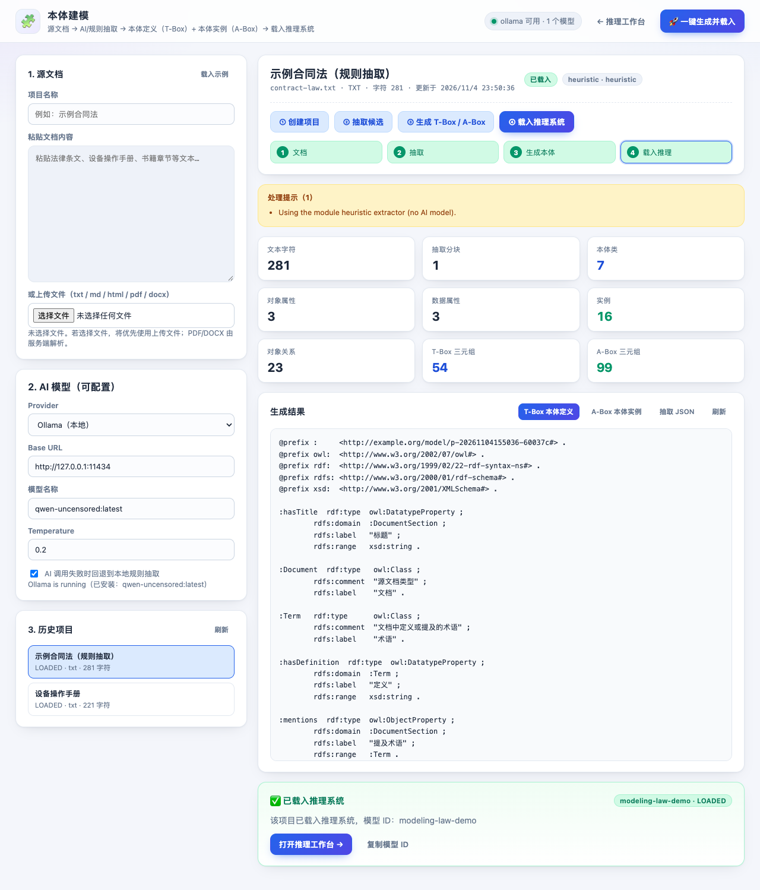

# 文档驱动本体建模模块（文档 → T-Box + A-Box → 推理系统）

本模块解决「给一套法律条文、一本设备操作手册或一本书，如何自动得到可推理的本体」的问题：

1. 上传/粘贴源文档（txt、md、html、pdf、docx）；
2. 用**可配置的 AI 模型**（本地 Ollama、OpenAI 兼容 API）或模块内置规则抽取器，把文档解释成结构化的本体候选；
3. 生成两份可独立保存、可版本化的 Turtle 文档：
   - `ontology.ttl`：**本体定义（T-Box）**：类、对象属性、数据属性、子类公理、传递属性等；
   - `instances.ttl`：**本体实例（A-Box）**：个体、对象关系、字面量；
4. 一键把生成结果载入现有推理系统，成为 `/models` 中一个普通模型，可切换、运行推理、SPARQL 查询、推导解释。



> 模块是同一个 Spring Boot 应用里的逻辑模块（包 `com.example.ontology.modeling`），不引入第二个服务。

---

## 1. 总体流程

```
源文档 (txt/md/html/pdf/docx)
        │  DocumentTextExtractor
        ▼
  纯文本 + 分块 (TextChunker)
        │
        ├── provider = ollama / openai ──► LlmClient ──► JSON 抽取结果
        ├── provider = heuristic        ──► HeuristicOntologyExtractor
        └── provider = mock             ──► MockLlmClient（测试/演示）
        ▼
  ExtractedOntology（classes / objectProperties / datatypeProperties /
                     subClassOf / individuals / relations / literals）
        │  OntologyTurtleBuilder（清洗标识符、补全引用、生成命名空间 IRI）
        ▼
  ontology.ttl (T-Box)  +  instances.ttl (A-Box)
        │  ModelService.load（文件型 A-Box 模式，不需要 TDSQL/Ontop）
        ▼
  多模型注册表 ModelRegistry：GET /models、POST /reason、POST /query、/explain
```

### 1.1 AI 抽取（chunked extraction）

- 长文档按 `chunk-size`（默认 3500 字符）切块，块间保留 `chunk-overlap`（默认 200 字符），最多发送 `max-chunks`（默认 15）块，避免一次请求过大。
- 每个块发送中文 system prompt + 文档名 + 片段，要求模型**只输出 JSON**；解析器容忍 Markdown 代码围栏、缺失字段、常见字段别名（如 `object_properties`、`dataProperties`、`instances`、`subclasses`）。
- 多块结果按类/属性/个体名称去重合并。
- `fallback-to-heuristic=true` 时：Ollama 不可达、单块调用失败或 JSON 无法解析，会自动退回该块的规则抽取，并在项目 `warnings` 中记录原因。生产环境可设 `false`，让 AI 不可用直接返回 HTTP 502。

### 1.2 规则抽取（无需 AI）

内置规则抽取器会识别：

- Markdown 标题（`#`/`##`）、中文「编/章/节」标题、编号标题；
- 中文「第 N 条 / 第 N 款」条文；
- 定义句：`“X”是指 / 指的是 / 定义为 ...`；
- 引号、书名号中的术语（`《...》`、`“...”`）。

产出一个总能载入推理系统的最小本体：

| 元素 | 说明 |
| --- | --- |
| 类 `Document` / `DocumentSection` / `Article` / `Term` | 文档、章节、条款、术语 |
| 类 `SectionType_<标题>` | 每个章/节标题一个类，`rdfs:subClassOf DocumentSection` |
| 对象属性 `hasSection`、`partOf`（传递属性）、`mentions` | 文档结构、章节归属、章节提及术语 |
| 数据属性 `hasTitle`、`hasText`、`hasDefinition` | 标题、条文正文、术语定义 |
| 个体 `document`、`section_<n>`、`term_<n>` | 文档、章节/条文、术语实例 |

规则抽取不需要任何外部服务，适合内网、离线演示和作为 AI 的兜底。

---

## 2. 快速开始

### 2.1 通过内置 Web 页面（推荐演示）

1. 启动服务：`./scripts/run-server.sh`（或 IDEA 运行 `OntologyApplication`）；
2. 打开 <http://localhost:8080/modeling.html>；
3. 左侧点击「载入示例」或粘贴自己的文档；选择 AI Provider：
   - 本地 Ollama（默认）：`http://127.0.0.1:11434` + 已安装的模型名；
   - OpenAI 兼容 API：填写 base URL、模型名（可选 API Key 由后端环境变量配置）；
   - 本地规则：无需 AI，离线可用；
4. 点击「🚀 一键生成并载入」；
5. 页面显示抽取/生成统计与 T-Box/A-Box 预览；点击「打开推理工作台 →」自动选中新模型。

也可以从主页面 <http://localhost:8080/> 右上角「🧩 本体建模」进入；载入成功后的跳转地址为 `/?model=<modelId>`。

### 2.2 通过 REST API

```bash
BASE=http://localhost:8080

# 1) 创建项目（内联文本）
PID=$(curl -s -X POST $BASE/modeling/projects \
  -H 'Content-Type: application/json' \
  -d '{"name":"示例合同法","fileName":"law.txt","content":"第一章 总则\n第一条 ……"}' \
  | python3 -c 'import sys,json; print(json.load(sys.stdin)["id"])')

# 2) 抽取。provider=heuristic 不需要 AI；也可换成 ollama/openai/mock
curl -s -X POST $BASE/modeling/projects/$PID/extract \
  -H 'Content-Type: application/json' \
  -d '{"provider":"heuristic"}'

# 2b) 用本地 Ollama 抽取
curl -s -X POST $BASE/modeling/projects/$PID/extract \
  -H 'Content-Type: application/json' \
  -d '{"provider":"ollama","baseUrl":"http://127.0.0.1:11434",
       "model":"qwen2.5:7b","timeoutSeconds":180,"fallbackToHeuristic":true}'

# 3) 生成 T-Box + A-Box
curl -s -X POST $BASE/modeling/projects/$PID/generate \
  -H 'Content-Type: application/json' -d '{}'

# 4) 载入推理系统（默认自动推理）
curl -s -X POST $BASE/modeling/projects/$PID/load \
  -H 'Content-Type: application/json' -d '{"autoReason":true}'

# 5) 像普通模型一样使用
curl -s $BASE/models
curl -s -X POST $BASE/reason -H 'Content-Type: application/json' \
  -d '{"modelId":"modeling-'$PID'"}'
curl -s -X POST $BASE/query -H 'Content-Type: application/json' \
  -d '{"modelId":"modeling-'$PID'","sparql":"SELECT ?s ?p ?o WHERE { ?s ?p ?o } LIMIT 20"}'

# 6) 下载生成的两份文档
curl -s $BASE/modeling/projects/$PID/ontology  -o ontology.ttl
curl -s $BASE/modeling/projects/$PID/instances -o instances.ttl
```

上传 PDF/DOCX 用 multipart：

```bash
curl -s -X POST $BASE/modeling/projects/upload \
  -F 'file=@manual.pdf' -F 'name=设备操作手册'
```

### 2.3 一键流水线

```bash
curl -s -X POST $BASE/modeling/projects/$PID/pipeline \
  -H 'Content-Type: application/json' \
  -d '{
        "extract": {"provider":"heuristic"},
        "generate": {"includeSourceComments": true},
        "load": {"modelId":"contract-law","autoReason":true}
      }'
```

响应中的 `loaded` 字段与 `POST /load` 的响应一致，包含 `model`（`ModelDetail`）和 `reasoning`（推理统计）。

---

## 3. 本地 Ollama 配置

```bash
# 1) 启动 Ollama（macOS 安装包/Homebrew 安装后通常已作为服务运行）
ollama serve

# 2) 拉取一个适合中文抽取的模型（示例）
ollama pull qwen2.5:7b

# 3) 确认服务端能发现它
curl -s http://localhost:8080/modeling/ai/status
# {"provider":"ollama","baseUrl":"http://127.0.0.1:11434","model":"qwen2.5:7b",
#  "reachable":true,"models":["qwen2.5:7b"],"message":"Ollama is running"}
```

也可以直接调用 Ollama 自带的 OpenAI 兼容接口：Provider 选 `openai`，Base URL 填
`http://127.0.0.1:11434`（模块会请求 `/v1/chat/completions`）。

AI 相关配置全部可通过环境变量覆盖（见第 5 节），无需改代码。

> 实测（本机 Ollama `qwen-uncensored:latest`，27.3B Q4_K_M，221 字中文设备手册）：单块抽取耗时约 264 秒，
> 得到 15 个类、11 个对象属性、9 个数据属性、16 个个体；生成 T-Box 132 三元组、A-Box 76 三元组，推理得到 3 条新类型断言。
> 大模型首次加载/生成较慢，现场演示建议使用 7B 级别的中文模型，并把 `timeout-seconds` 设为 120–180。

---

## 4. REST API

所有接口都在 `/modeling` 下，JSON 命名风格与现有模型接口一致；错误响应复用统一 `ErrorResponse`。

| 方法 | 路径 | 说明 |
| --- | --- | --- |
| `POST` | `/modeling/projects` | 用 JSON 内联文本创建项目：`{name,fileName,mimeType,content}` |
| `POST` | `/modeling/projects/upload` | 用 multipart 上传文件创建项目：`file`、可选 `name`；支持 txt/md/html/pdf/docx |
| `GET` | `/modeling/projects` | 项目列表（按创建时间倒序） |
| `GET` | `/modeling/projects/{projectId}` | 项目详情（含统计、警告、三类内容预览） |
| `DELETE` | `/modeling/projects/{projectId}` | 删除项目文件；若已载入推理模型则同时卸载 |
| `POST` | `/modeling/projects/{projectId}/extract` | 抽取本体候选；body 见下 |
| `POST` | `/modeling/projects/{projectId}/generate` | 生成 T-Box/A-Box；body `{namespace?, includeSourceComments?}` |
| `POST` | `/modeling/projects/{projectId}/load` | 载入推理系统；body `{modelId?, name?, description?, autoReason?, replace?}` |
| `POST` | `/modeling/projects/{projectId}/pipeline` | 抽取 + 生成 + 载入一步完成 |
| `GET` | `/modeling/projects/{projectId}/ontology` | 下载 T-Box（`text/turtle`） |
| `GET` | `/modeling/projects/{projectId}/instances` | 下载 A-Box（`text/turtle`） |
| `GET` | `/modeling/projects/{projectId}/extraction` | 下载抽取结果（JSON） |
| `GET` | `/modeling/ai/status` | AI 后端配置/可达性/已安装模型；不会返回 API Key |

### 4.1 `POST /modeling/projects/{id}/extract`

```json
{
  "provider": "ollama",              // ollama | openai | heuristic | mock，默认取 app.modeling.ai.provider
  "baseUrl": "http://127.0.0.1:11434",
  "model": "qwen2.5:7b",
  "apiKey": "可选，通常建议用环境变量配置",
  "temperature": 0.2,
  "timeoutSeconds": 180,
  "fallbackToHeuristic": true,
  "chunkSize": 3500,
  "maxChunks": 15
}
```

所有字段可选；请求级字段覆盖全局默认值。`provider` 非法时返回 HTTP 400 `MODELING_ERROR`。

### 4.2 `POST /modeling/projects/{id}/load`

```json
{
  "modelId": "contract-law",   // 可选；默认 modeling-{projectId}
  "name": "示例合同法（生成）",
  "description": "由本体建模模块生成",
  "autoReason": true,          // 默认 true
  "replace": true              // 模型 ID 已存在时是否先卸载重建，默认 true
}
```

返回：

```json
{
  "project": { "id": "...", "status": "LOADED", "modelId": "contract-law", ... },
  "model":   { "id": "contract-law", "profile": "local", "aboxSource": "local", ... },
  "reasoning": { "state": "REASONED", "inferredTotal": 12, "materializeEnabled": false, ... }
}
```

### 4.3 项目详情中的文件与预览

`GET /modeling/projects/{id}` 返回：

- `statistics`：文本字符、分块数、类/属性/个体/关系数量、T-Box/A-Box 三元组数、耗时；
- `warnings`：AI 回退、文档过长被截断等提示；
- `files`：`sourceText` / `extraction` / `ontology` / `instances` 的本地绝对路径；
- `extractionPreview` / `ontologyPreview` / `instancesPreview`：分别截断到约 12000 字符的预览（完整内容用下载接口）。

---

## 5. 配置项

`src/main/resources/application.yml` 的 `app.modeling.*`（均可用环境变量覆盖）：

| 配置 | 环境变量 | 默认值 | 说明 |
| --- | --- | --- | --- |
| `app.modeling.data-dir` | `APP_MODELING_DATA_DIR` | `data/modeling` | 建模项目工作目录 |
| `app.modeling.namespace-base` | `APP_MODELING_NAMESPACE_BASE` | `http://example.org/model/` | 生成命名空间前缀，实际为 `<base><projectId>#` |
| `app.modeling.chunk-size` | `APP_MODELING_CHUNK_SIZE` | `3500` | 每块目标字符数 |
| `app.modeling.chunk-overlap` | `APP_MODELING_CHUNK_OVERLAP` | `200` | 块间重叠字符数 |
| `app.modeling.max-chunks` | `APP_MODELING_MAX_CHUNKS` | `15` | 单次最多发送块数 |
| `app.modeling.max-document-bytes` | `APP_MODELING_MAX_DOCUMENT_BYTES` | `5242880` | 上传文档大小上限（5 MB） |
| `app.modeling.ai.provider` | `APP_MODELING_AI_PROVIDER` | `ollama` | `ollama` / `openai` / `heuristic` / `mock` |
| `app.modeling.ai.base-url` | `APP_MODELING_AI_BASE_URL` | `http://127.0.0.1:11434` | Ollama 或 OpenAI 兼容地址 |
| `app.modeling.ai.model` | `APP_MODELING_AI_MODEL` | `qwen2.5:7b` | 默认模型名 |
| `app.modeling.ai.api-key` | `APP_MODELING_AI_API_KEY` | 空 | OpenAI 兼容接口的 Bearer Token |
| `app.modeling.ai.timeout-seconds` | `APP_MODELING_AI_TIMEOUT_SECONDS` | `180` | 单次 AI 请求超时 |
| `app.modeling.ai.temperature` | `APP_MODELING_AI_TEMPERATURE` | `0.2` | 采样温度 |
| `app.modeling.ai.fallback-to-heuristic` | `APP_MODELING_AI_FALLBACK_TO_HEURISTIC` | `true` | AI 失败时是否回退规则抽取 |

上传接口还受 `spring.servlet.multipart.max-file-size`（默认 20 MB）限制；建模模块自身会在
`max-document-bytes`（默认 5 MB）处再校验一次，超出返回 400 `MODELING_ERROR`。

---

## 6. 生成的文件与命名空间

每个项目一个目录：

```
data/modeling/{projectId}/
├── source.<ext>          # 原始上传文件（若有）
├── source.txt            # 解析后的纯文本
├── extraction.json       # 抽取结果（ExtractedOntology JSON）
├── ontology.ttl          # 生成的 T-Box
├── instances.ttl         # 生成的 A-Box
└── meta.json             # 项目元数据（状态、统计、AI 配置、警告、modelId）
```

载入推理系统时，模型文件被复制到 `data/models/{modelId}/`（与手工 `/load` 的模型一致）。

生成 IRI 使用项目命名空间：

```turtle
@prefix : <http://example.org/model/p-20260101120000-abcdef#> .
:Document a owl:Class .
:section_1 a owl:NamedIndividual, :SectionType_总则 ;
    :hasTitle "总则" ;
    :hasText "第一条 ……" .
```

- 默认命名空间 `<namespace-base><projectId>#`，可用 `generate.namespace` 显式指定；
- 生成时会对类/属性/个体名称做标识符清洗（空格、标点转 `_`，数字开头加 `N_`），并自动补全被关系/domain/range 引用但未声明的类；
- 生成后会先重新解析校验 Turtle，保证 `ModelService` 可加载。

---

## 7. 文件型 A-Box 与多模型切换

原来的模型加载要求「本地 T-Box + OBDA 映射 + TDSQL」，本模块新增了**文件型 A-Box 模式**：

- `POST /load` 请求新增 `instancesPath` / `instancesContent`；
- 若只提供本体 + `instances`（没有 mapping），则跳过 Ontop/JDBC，直接读取本地 `instances.ttl`，模型 `profile` 为 `local`、`aboxSource` 为 `local`；
- 若同时提供 mapping 和 instances，则为 `mixed`（TDSQL 虚拟 A-Box + 本地 A-Box 合并）；
- 文件型模型没有 TDSQL 表，因此 `/reason` 的物化自动关闭（`materializeEnabled=false`），其余推理、查询、解释能力不变；
- 所有模型仍在同一个 `ModelRegistry` 中，通过 `modelId` 切换；`GET /models` 会返回 `aboxSource` 字段。

生成的模型同样支持 **动态前缀**：服务端会把 SPARQL 的 `:` 前缀绑定到当前模型的命名空间，因此
`SELECT ?s WHERE { ?s a :Document }` 对生成模型可用；手工模型仍绑定 `http://example.org/company#`。

---

## 8. 错误码与限制

| HTTP | code | 场景 |
| --- | --- | --- |
| 400 | `MODELING_ERROR` | 未提供文档、文档过大、格式不支持、provider 非法、未抽取就生成、未生成就载入 |
| 404 | `MODELING_PROJECT_NOT_FOUND` | 项目 ID 不存在 |
| 404 | `MODEL_NOT_FOUND` | 载入后模型 ID 不存在（模型接口） |
| 409 | `DUPLICATE_MODEL` | `/load` 指定了已存在的 modelId 且 `replace=false` |
| 413 | `FILE_TOO_LARGE` | multipart 超过 `spring.servlet.multipart.max-file-size` |
| 502 | `AI_SERVICE_ERROR` | AI 服务不可达/超时，且 `fallbackToHeuristic=false` |
| 500 | `MODELING_FAILED` | 其它未预期异常（含统一异常处理） |

限制与建议：

- PDF 文本提取依赖 PDFBox；扫描版 PDF（图片）需要先 OCR；
- DOCX 仅解析 `word/document.xml` 的文本，不处理复杂表格/图片；
- AI 结果可能包含幻觉或重复概念，生成前建议先预览/人工校对 `extraction.json`；内网场景建议用规则抽取或小模型；
- AI 请求会把文档片段发送给所配置的模型服务；涉密文档请使用本地 Ollama/本地模型，或使用 `heuristic`；
- 项目文件与生成文档都是普通本地文件，可直接纳入 Git 或制品库做版本管理。

---

## 9. 测试

```bash
./scripts/build.sh test
```

建模模块相关测试：

- `ModelingApiTest`（13 个）：创建（内联/上传）、规则抽取、T-Box/A-Box 生成与下载、文件型模型载入、推理、模型列表、动态前缀查询、推导解释、Mock AI 一键流水线、错误处理、AI 状态、删除级联卸载；
- `DocumentTextExtractorTest`（5 个）：txt/html/docx/pdf/二进制垃圾；
- `HeuristicOntologyExtractorTest`（2 个）：法律文本结构、纯文本术语；
- `TextChunkerTest`（3 个）：分块、重叠、截断；
- `OntologyJsonParserTest`（2 个）：代码围栏/字段别名、非法 JSON；
- `OntologyTurtleBuilderTest`（1 个）：生成 T-Box/A-Box 并可被 Jena 重新解析；
- `OntologyReasoningApiTest` 新增文件型 A-Box 用例。

全部测试共 **51 个**，详见 README「测试」一节。
